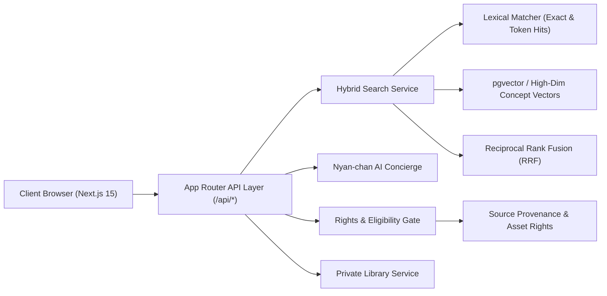

# Nyamora Architecture Specification

## 1. High-Level System Flow

---

## 2. Hybrid Retrieval Pipeline

1. **Query Normalization**:
   - Detect language.
   - Extract negations: `not X`, `without X`, `avoid X`, `-tag`, `no X`.
   - Identify include tags, creator terms, and broad concepts.
2. **Lexical Scoring**:
   - Exact title match receives substantial boost (+50).
   - Alternate Japanese titles matched (+25).
   - Creator exact/partial name matched (+12–20).
   - Tag match (+15).
   - Description match (+3).
3. **Vector Semantic Scoring**:
   - Computes normalized high-dimensional concept embeddings for the query and compares against precomputed item embeddings via **Cosine Similarity**.
4. **Strict Exclusion Filtering**:
   - Records with any excluded tag or custom excluded term are removed server-side prior to ranking.
5. **Reciprocal Rank Fusion (RRF)**:
   $$RRF(d) = \frac{1}{60 + \text{rank}_{\text{lexical}}(d)} + \frac{0.7}{60 + \text{rank}_{\text{vector}}(d)}$$
6. **Grounding & Match Explanation**:
   - Matches are tagged with verified explanations (e.g., `Exact title match`, `Creator: Nagisa Chiaki`, `Semantic concept similarity (78%)`).

---

## 3. Data Integrity & Invariants

- **Separation of Concerns**: Stored catalogue facts, source provenance, asset rights, and reader availability are maintained in distinct entities. An item is not accessible merely because metadata was ingested.
- **Reader Rights Gate**: Integrated reader access requires:
  1. `availabilityMode === 'integrated_licensed'`
  2. `assetRights.reviewStatus === 'approved'`
  3. Valid non-expired license record in `asset_rights`.
  Otherwise, it defaults to metadata-only or an external outbound partner link.
- **Privacy Vault**: Bookmarks, custom lists, and reading positions are private to the user. No public interest profiling, zero ad-broker tracking.
